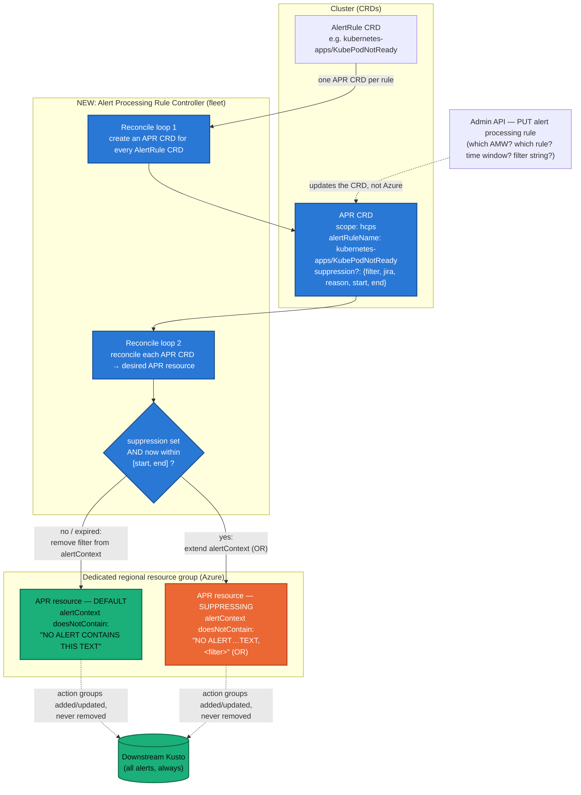

# Design: Alert Processing Rule controller in fleet (ARO-30315)

## Overview

Instead of the admin API creating/deleting Alert Processing Rule (APR) **Azure
resources** directly (which strip *all* action groups when suppressing, dropping
alerts from Kusto), a **new APR controller in the fleet manager** owns the APR
resources. The controller keeps one long-lived APR resource per alert rule and
only ever **adds/updates** action groups — never removes them — so every alert
continues to flow to the Event Hub and on to Kusto. Suppression is expressed by
extending an `alertContext` filter, not by tearing down action groups.

The admin API's `PUT` contract now updates an **APR CRD** in the cluster; the
controller reconciles that CRD into the desired Azure APR resource.

## Flow



## APR CRD

Reconcile loop 1 creates one APR CRD per AlertRule CRD in the cluster:

```yaml
apiVersion: monitoring.aro-hcp.io/v1alpha1
kind: AlertProcessingRule
metadata:
  name: kubepodnotready-hcps
spec:
  scope: hcps                                      # AMW family: hcps-* or services-*
  alertRuleName: kubernetes-apps/KubePodNotReady
  # optional — set/cleared by the admin API PUT:
  suppression:
    filter: ocm-arohcpint-2tp8ergr17b7anmbk8c6csepetd3lidg
    jira: ARO-1234
    reason: Noisy customer
    start: 2026-10-30T00:00:00
    end: 2026-10-31T00:00:00
```

## Desired APR resource

Reconcile loop 2 renders each APR CRD into a desired APR resource in the dedicated
regional RG.

**Default** (no suppression, or outside the `[start, end]` window) — the
`alertContext` condition carries a sentinel that matches no alert, so the rule's
action groups always apply:

```yaml
scope: <AMW resource ID that matches the scope defined on the CRD>
filters:
  - field: alertRuleName
    operation: equals
    value: kubernetes-apps/KubePodNotReady
  - field: alertContext
    operation: doesNotContain
    values:
     - "NO ALERT CONTAINS THIS TEXT"
```

**Suppressing** (suppression set *and* within the window) — the controller
extends the existing `alertContext` `doesNotContain` condition with the filter
string (expressed as an OR):

```yaml
scope: <AMW resource ID that matches the scope defined on the CRD>
filters:
  - field: alertRuleName
    operation: equals
    value: kubernetes-apps/KubePodNotReady
  - field: alertContext
    operation: doesNotContain
    values:
     - "NO ALERT CONTAINS THIS TEXT"
     - "ocm-arohcpint-2tp8ergr17b7anmbk8c6csepetd3lidg"
```

When the CRD falls **outside** its time window, loop 2 updates the APR resource to
remove the suppression filter from the `alertContext` condition, returning it to
the default form above — no background cleanup task required.

## What this changes

1. **Action groups are only added/updated, never removed**, so all alerts keep
   flowing to Kusto.
2. **No background task to clean up expired APRs.** APRs are long-lived, one per
   AlertRule CRD; the default behavior applies the ICM action group (configurable
   per alert rule).
3. **The admin API no longer needs permissions to touch APR Azure resources
   directly** — it only writes the APR CRD.
4. **The new fleet APR controller does the heavy lifting** (CRD fan-out + resource
   reconciliation + time-window handling).
5. **Operators are hidden from APR-resource details.** They only think in terms of
   *which AMW? which rule? time window? filter string?* `Delete` disappears
   from the admin API and perhaps `List`/`Get` as well. Visibility into suppression
   status could be derived from metrics generated by the reconciliation loop.
6. **May need to join ICM kusto to understand what was suppressed.** There does not
   appear to be a way to distinguish which alerts were suppressed in kusto with
   this method, so this may need to be inferred by joining with ICM kusto.
7. **Scheduling logic is moved entirely to new fleet controller.** The permanent
   nature of the APR makes the use of the schedule properties untenable. Instead
   scheduling of suppression is fully the responsibility of the controller's
   reconciliation loop.
